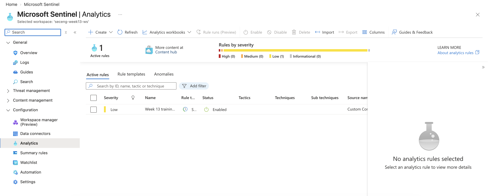
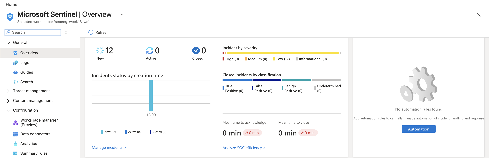

# azure-sentinel-lab

A short, live Microsoft Sentinel lab in an Azure Free Trial subscription, and a brief that
compares AWS IAM, Azure RBAC and Google Cloud IAM. The lab ran for about two hours on
2026-11-12 and was then deleted.

The lab proves one detection chain from end to end:

```
action -> Activity Log -> diagnostic setting -> AzureActivity table
       -> scheduled analytics rule -> alert -> incident
```

Each link is proved with the request's correlation ID.

## What it does

The lab created:

- A Log Analytics workspace, `seceng-week13-ws` (eastus), with a 0.1 GB daily cap.
- Microsoft Sentinel, switched on for that workspace.
- A subscription diagnostic setting that sends the Activity Log (Administrative, Security,
  Policy and Alert) to the workspace.
- One scheduled analytics rule that runs [`rule.kql`](rule.kql): Low severity, every 5
  minutes, 30-minute lookback, one alert per result, alert when there is more than 0 results.
- Two empty resource groups: `seceng-week13-signal` for the test signal and
  `seceng-week13-baseline` for the benign check.

Then it changed a tag on each group. The rule must alert on the signal group and must not
alert on the baseline group.

Everything was created with the Azure CLI and the ARM REST API, not the portal. The rule's
full definition, as Azure returned it, is [`evidence/analytics-rule.json`](evidence/analytics-rule.json).
To run it again, create the workspace, the diagnostic setting and the two groups, then
`PUT` that JSON to the workspace's `Microsoft.SecurityInsights/alertRules` endpoint. Use a
throwaway subscription with a spending limit.

## Result

| Check | Evidence | Result |
|---|---|---|
| Both tag changes reached `AzureActivity` | [ingestion-and-query.txt](evidence/ingestion-and-query.txt) | yes, about two minutes after the change |
| The query selects the signal change and not the baseline change | [ingestion-and-query.txt](evidence/ingestion-and-query.txt) | yes |
| The signal change became an alert and an incident | [alerts.txt](evidence/alerts.txt) | alert `120d6045` at 21:49:58 UTC, incident 2 |
| The baseline change raised no alert | [alerts.txt](evidence/alerts.txt) | 0 alerts carry its correlation ID |
| Cost | [ingestion-and-query.txt](evidence/ingestion-and-query.txt) | `_IsBillable = False` on every row |
| Teardown | [teardown.txt](evidence/teardown.txt) | no diagnostic setting, no soft-deleted workspace left |





The subscription ID and the caller's identity are replaced with placeholders in the
evidence. The teardown check listed one resource group that existed before the lab and was
not touched; its name is removed.

## What was learned

- **Two events made twelve incidents.** The rule runs every 5 minutes but looks back 30, so
  each event sat inside six runs and each run alerted on it again. When the lookback is longer
  than the schedule, set the lookback to the schedule plus the ingestion delay, or turn on
  suppression.
- **A filter on an operation name catches every write of that kind.** The signal group's own
  creation matched the rule too, because it is the same operation as a tag change. Check what
  else a query selects before you trust it.
- **A benign check counts only if the benign event arrived.** An empty alert list proves
  nothing until you show the event reached the table.
- **Azure Activity is free to ingest.** Every row was `_IsBillable = False`. It stays free
  only with retention of 90 days or less.
- **The three clouds answer one question.** May this principal do this action on this
  resource? Azure grants a role at a scope and the grant flows down. Google binds a role in an
  allow policy on a resource. AWS attaches policies to identities or resources. See
  [docs/iam-comparison.md](docs/iam-comparison.md).
